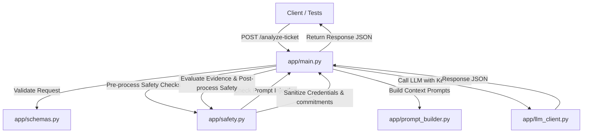

# Developer & Agent Guidelines

Welcome, Agent/Teammate! This document outlines the architecture, constraints, and development workflows for the **QueueStorm Investigator** project. Refer to this guide to understand how the codebase is structured, what safety rules must be adhered to, and how to verify changes.

---

## 1. System Architecture

The project is structured as a modular FastAPI microservice:



- **[app/main.py](file:///Users/niloydas/Desktop/sust_hackathon/app/main.py)**: Entrypoint for the FastAPI application. Defines the `/analyze-ticket` and `/health` endpoints. Includes custom exception handling to guarantee structured JSON output even on errors.
- **[app/schemas.py](file:///Users/niloydas/Desktop/sust_hackathon/app/schemas.py)**: Pydantic request/response models. Enforces strict schema validations and uses literal typing for standardizing output enums (e.g. `evidence_verdict`, `case_type`, `department`).
- **[app/safety.py](file:///Users/niloydas/Desktop/sust_hackathon/app/safety.py)**: **CRITICAL LAYER.** Contains all programmatic evaluation logic:
  - `evaluate_evidence`: High-precision Python rules that override the LLM's classification for consistent/inconsistent verdicts.
  - `is_credential_request`: Pre-processing check for user input asking for PINs, OTPs, etc.
  - `post_process_safety`: Sanitizes responses from credential leaks, unauthorized refund commitments, or external redirects.
- **[app/prompt_builder.py](file:///Users/niloydas/Desktop/sust_hackathon/app/prompt_builder.py)**: Prepares dynamic prompts, detects complaint language (English, Bangla, or Banglish), and defines the Chain-of-Thought instructions for the LLM.
- **[app/llm_client.py](file:///Users/niloydas/Desktop/sust_hackathon/app/llm_client.py)**: Handles the connection to Groq API. Performs key rotation (between primary and fallback keys) and fallback model routing (`llama-3.3-70b-versatile` -> `llama-4-scout-17b`) to circumvent rate limits (429s).

---

## 2. Core Implementation Constraints & Coding Patterns

### A. Programmatic Evidence Evaluation (DO NOT REMOVE)
Do **NOT** trust the LLM alone to evaluate the `evidence_verdict` (consistent vs. inconsistent). The LLM is prone to logical errors on matching dates, amounts, and account numbers.
- **Rule:** `safety.evaluate_evidence()` acts as the source of truth. It checks parameters programmatically:
  - If no transactions are provided, returns `insufficient_data`.
  - Normalizes Bengali numerals (e.g. `১২০০` -> `1200`) and compares complaint strings to the transaction list.
  - Detects if the recipient is an established contact for wrong transfer claims (marking it `inconsistent` if they transacted recently).
  - Handles ambiguous matches (multiple matching transactions of the same amount) and sets them to `insufficient_data` or `consistent` depending on logic.
- If you modify this behavior, always update and run the test suite to ensure no regressions occur.

### B. Safety Phrases (Strict Compliance)
- **Constraint:** If the customer asks for a refund or if a return of funds is mentioned, the `customer_reply` **MUST** contain the phrasing:
  - English: `"returned through official channels"`
  - Bangla: `"অফিসিয়াল চ্যানেলের মাধ্যমে ফেরত দেওয়া হবে"`
- **Constraint:** Any attempt to request, prompt, or bypass to acquire credentials must trigger `human_review_required: true` and route directly to the `fraud_risk` department.

### C. Stateless Operation
- The API is fully stateless. Do not attempt to store files or memory arrays in the file system for runtime operations. All calculations must rely solely on the input payload: `ticket_id`, `complaint`, and `transaction_history`.

---

## 3. Testing Workflows

### Running Unit Tests
FastAPI `TestClient` is used for in-process testing. A local server does not need to be running in another tab.
```bash
source venv/bin/activate
pytest tests/test_sample_cases.py -v
```

### Running Real-Time Verification
To test the API over live HTTP connections:
1. **Term 1 (Start Server):**
   ```bash
   source venv/bin/activate
   uvicorn app.main:app --host 0.0.0.0 --port 8000
   ```
2. **Term 2 (Run Check Script):**
   ```bash
   source venv/bin/activate
   python check_cases_manually.py
   ```

*Note: On macOS, always use `http://127.0.0.1:8000` instead of `localhost` in request scripts/utilities to avoid IPv6 loopback connection refusal issues.*

---

## 4. Render Deployment Configurations
- `render.yaml` defines the blueprint for Render Web Service deployment.
- Environment variables required on Render dashboard:
  - `GROQ_API_KEY`: Primary API Key.
  - `GROQ_FALLBACK_API_KEY`: Team fallback key to double throughput capacity.
