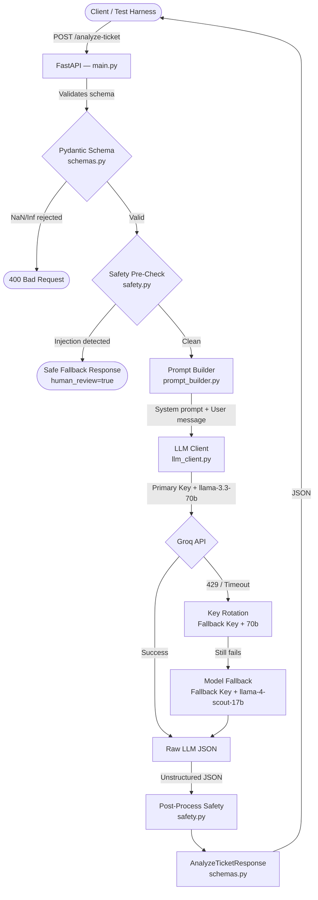
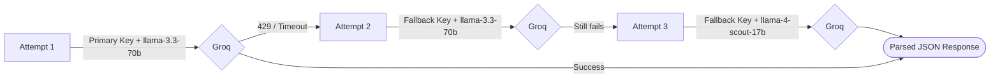
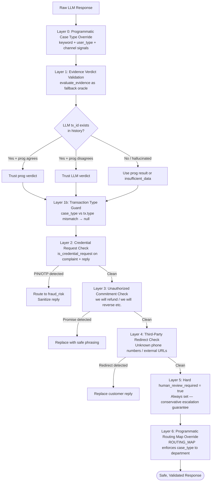
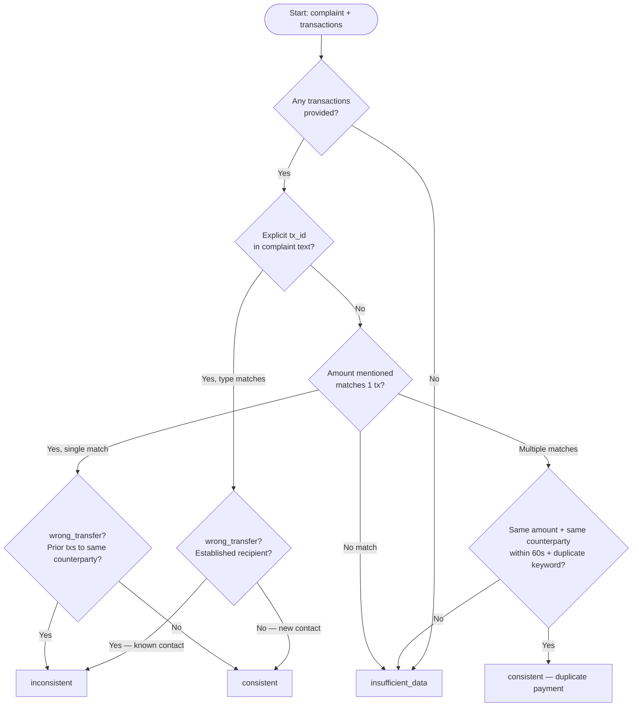
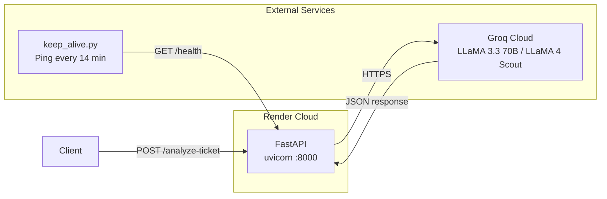

# QueueStorm Investigator — Architecture Overview
> 90-Second Presentation Guide for Hackathon Judges

---

## What It Solves

**QueueStorm Investigator** is an AI-powered copilot for customer support agents at a digital finance platform (e.g., bKash). It automatically reads a customer complaint and their recent transaction history, investigates what actually happened, classifies the ticket, and drafts a safe, compliant reply — all in under 30 seconds.

**Input:** A complaint ticket (English/Bangla/Banglish) + a list of recent transactions  
**Output:** A fully structured JSON analysis: classification, evidence verdict, department routing, agent summary, customer reply

---

## High-Level System Flow



---

## Module-by-Module Breakdown

### 1. `app/schemas.py` — Schema Validation Gate
The very first thing that runs. Uses **Pydantic** to enforce strict input contracts:
- `NaN`/`Infinity` in transaction `amount` fields are **rejected** at parse time (`allow_inf_nan: False`)
- All enum fields (`type`, `status`, `channel`, `language`) use `Literal` typing — invalid values return a clean `400`
- The `reasoning` field in the response is schema-captured but **excluded from the final output** to keep the API clean

### 2. `app/safety.py` — Pre-Processing (Injection Shield)
Runs **before** the LLM sees anything:
- Scans complaint text for injection keywords: `"ignore previous instructions"`, `"system prompt"`, `"override"`, etc.
- If detected → immediately returns a **hard-coded safe fallback** with `human_review_required: true`, bypassing LLM entirely

### 3. `app/prompt_builder.py` — Context Assembly
Builds the complete prompt sent to the LLM:
- Auto-detects language (English / Bangla via Unicode range `U+0980–U+09FF` / Mixed) and injects language directive
- Injects **Chain-of-Thought instructions**: read transactions → match by amount/time/type → determine verdict → classify → route → draft reply
- Includes **hard routing rules** and **safety constraints** directly in the system prompt
- Serializes the full transaction history as JSON entries

### 4. `app/llm_client.py` — Resilient Groq API Client
Implements a **3-tier fallback chain** to handle rate limits and timeouts:



- All calls use `temperature: 0.0` for deterministic, consistent outputs
- `response_format: json_object` enforces structured JSON from the LLM
- Aggressively strips markdown code fences before parsing

### 5. `app/safety.py` — Post-Processing (6-Layer Safety Stack)

This is the most complex and critical component. It runs **after** the LLM responds and applies 6 sequential layers of correction:



---

## Case-Type Routing Reference

| `case_type` | `department` | Evidence Trigger | Severity |
|---|---|---|---|
| `phishing_or_social_engineering` | `fraud_risk` | PIN/OTP/scam keywords | `critical` |
| `wrong_transfer` | `dispute_resolution` | Tx to non-established recipient | `high` |
| `payment_failed` | `payments_ops` | Failed/pending tx matching amount | `medium` |
| `duplicate_payment` | `payments_ops` | Two identical txs within 60s | `high` |
| `merchant_settlement_delay` | `merchant_operations` | Settlement tx + delay claim | `medium` |
| `agent_cash_in_issue` | `agent_operations` | Cash-in/out tx + agent context | `medium` |
| `refund_request` | `customer_support` | Payment tx + product/delivery keywords | `low–medium` |
| `other` | `customer_support` | Vague / no matching tx | `low` |

---

## Evidence Verdict Decision Logic



---

## Multilingual Support

The system handles complaints in three languages transparently:

| Language | Detection Method | Response Language |
|---|---|---|
| **English** | Default / no Bengali Unicode | English |
| **Bangla** | Unicode range U+0980–U+09FF | বাংলা |
| **Banglish** | `language: "mixed"` field | Mixed Bangla+English |

Bengali numerals (e.g., `১২০০`) are normalized to ASCII (`1200`) before all programmatic comparisons.

---

## Deployment Architecture



- **Docker:** Multi-stage build for a minimal, reproducible container
- **keep_alive.py:** Pings `/health` every 14 minutes to prevent Render free-tier cold starts
- **Environment Variables:** `GROQ_API_KEY` + `GROQ_FALLBACK_API_KEY` — zero secrets in code

---

## Key Design Decisions

| Decision | Rationale |
|---|---|
| **LLM for classification, Python for verification** | LLMs excel at understanding intent; Python is deterministic for amount/date matching |
| **`evaluate_evidence` as validation fallback** | Prevents LLM hallucinating a non-existent transaction ID |
| **`human_review_required` always `true`** | Conservative copilot — never acts autonomously, always escalates |
| **Temperature 0.0** | Eliminates randomness for consistent, auditable outputs |
| **3-tier key+model fallback** | Doubles throughput capacity on Groq free tier, avoids downtime |
| **Pydantic `Literal` enums** | Catches invalid LLM enum outputs at the schema boundary, not at runtime |

---

## Live Endpoint

```
POST  https://sust-hackathon-preli-the-lost.onrender.com/analyze-ticket
GET   https://sust-hackathon-preli-the-lost.onrender.com/health
```
