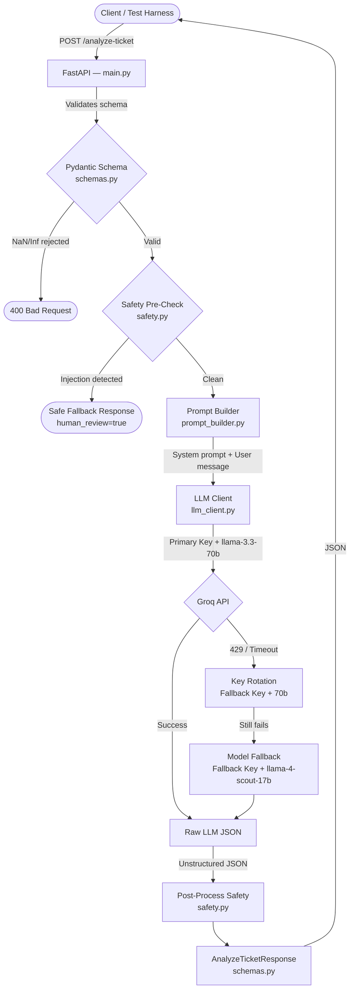
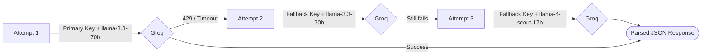
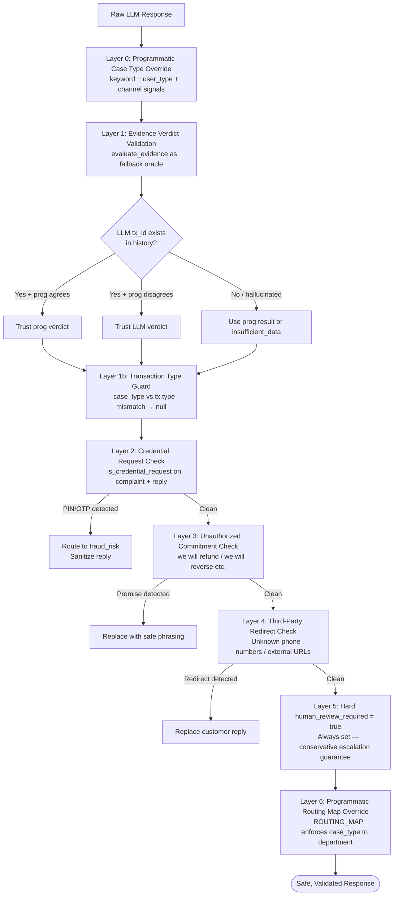
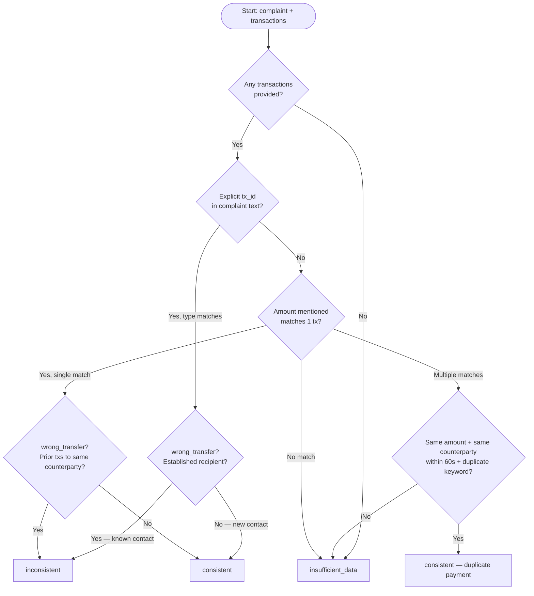

# QueueStorm Investigator

### Team: **The Lost Cartographer**
**Members:**
1. Niloy Das Robin
2. Nawriz Ahmed Turjo
3. Ahmed Sajid Hasan

*Built for SUST CSE Hackathon - Preliminary round*

---

An AI-powered internal copilot for support agents to automate complaint classification, evidence gathering, and response drafting for a digital finance platform (e.g., bKash).

**Input:** A complaint ticket (English / Bangla / Banglish) + a list of recent transactions  
**Output:** A fully structured JSON analysis — classification, evidence verdict, department routing, agent summary, customer reply

---

## Features

- **Evidence-Based Reasoning** — Cross-references customer complaints against transaction history to determine if claims are consistent, inconsistent, or unsupported.
- **Auto-Routing** — Classifies complaints into 8 case types and routes them to 6 specific departments based on strict programmatic rules.
- **6-Layer Safety Guardrails** — Hardcoded pre-processing (prompt injection shield) and post-processing (credential leak, unauthorized commitment, and redirect sanitization).
- **Multilingual Support** — Supports English, Bangla, and Banglish (auto-detected).
- **High Reliability** — Stateless architecture with 3-tier API key rotation and model fallback chains to handle Groq rate limits.

---

## Setup & Installation

1. **Clone the repository** and navigate to the root directory.
2. **Create and activate a virtual environment:**
   ```bash
   python -m venv venv
   # Windows
   venv\Scripts\activate
   # macOS / Linux
   source venv/bin/activate
   ```
3. **Install dependencies:**
   ```bash
   pip install -r requirements.txt
   ```
4. **Configure environment variables:**
   Copy `.env.example` to `.env` and insert your Groq API keys:
   ```bash
   cp .env.example .env
   ```
   ```env
   GROQ_API_KEY=gsk_...
   GROQ_FALLBACK_API_KEY=gsk_...   # optional but recommended for higher throughput
   ```

---

## Running the Server

```bash
uvicorn app.main:app --host 0.0.0.0 --port 8000
```

The server starts on `http://127.0.0.1:8000`.  
Interactive Swagger docs are available at `http://127.0.0.1:8000/docs`.

---

## Testing & Verification

### Method A — Automated Tests (Pytest, recommended)

Uses an in-process FastAPI `TestClient`. No separate server window needed.

```bash
pytest tests/test_sample_cases.py -v
```

Covers: health check, prompt injection, malformed JSON, ticket ID echo, latency, and all 10 sample cases.

### Method B — Live Verification Script

With the server running in one terminal, run in a second terminal:

```bash
python check_cases_manually.py
```

### Method C — Hidden/Edge Case Runner

Tests the extended edge-case suite against local or remote:

```bash
# Against local server
python check_hidden_cases.py

# Against live Render deployment
python check_hidden_cases.py https://sust-hackathon-preli-the-lost.onrender.com
```

### Method D — Sample Case Output Generator

Runs all 10 public sample cases and writes the outputs to `QueueStorm_Preli_Sample_Cases.json`:

```bash
python scratch/run_sample_cases.py
```

---

## Live Deployment

```
POST  https://sust-hackathon-preli-the-lost.onrender.com/analyze-ticket
GET   https://sust-hackathon-preli-the-lost.onrender.com/health
```

Hosted on **Render (free tier)**. `keep_alive.py` pings `/health` every 14 minutes to prevent cold starts.

---

## API Reference

### `GET /health`

Returns service liveness status.

**Response `200 OK`:**
```json
{ "status": "ok" }
```

---

### `POST /analyze-ticket`

Analyzes a support ticket and returns a structured investigation result.

#### Request Body

| Field | Type | Required | Description |
|---|---|---|---|
| `ticket_id` | `string` | ✅ | Unique identifier for the ticket |
| `complaint` | `string` | ✅ | The customer's complaint text |
| `language` | `"en" \| "bn" \| "mixed"` | ❌ | Overrides auto-detected language |
| `channel` | `"in_app_chat" \| "call_center" \| "email" \| "merchant_portal" \| "field_agent"` | ❌ | Support channel |
| `user_type` | `"customer" \| "merchant" \| "agent" \| "unknown"` | ❌ | Type of user submitting the complaint |
| `transaction_history` | `TransactionEntry[]` | ❌ | List of recent transactions |
| `metadata` | `object` | ❌ | Arbitrary additional context |
| `campaign_context` | `string` | ❌ | Optional campaign context |

**`TransactionEntry` schema:**

| Field | Type | Values |
|---|---|---|
| `transaction_id` | `string` | Any |
| `timestamp` | `string` | ISO 8601 (e.g. `2026-04-14T10:30:00Z`) |
| `type` | `string` | `transfer`, `payment`, `cash_in`, `cash_out`, `settlement`, `refund` |
| `amount` | `float` | Must be finite (NaN/Infinity rejected) |
| `counterparty` | `string` | Phone number, merchant ID, etc. |
| `status` | `string` | `completed`, `failed`, `pending`, `reversed` |

#### Response Body `200 OK`

| Field | Type | Description |
|---|---|---|
| `ticket_id` | `string` | Echoes the input ticket ID |
| `relevant_transaction_id` | `string \| null` | The transaction most relevant to the complaint |
| `evidence_verdict` | `"consistent" \| "inconsistent" \| "insufficient_data"` | Whether transaction history supports the claim |
| `case_type` | `string` | One of 8 case categories (see routing table) |
| `severity` | `"low" \| "medium" \| "high" \| "critical"` | Urgency level |
| `department` | `string` | Routing target (see routing table) |
| `agent_summary` | `string` | Internal summary for the support agent |
| `recommended_next_action` | `string` | Suggested action for the agent |
| `customer_reply` | `string` | Safe, pre-vetted reply to send to the customer |
| `human_review_required` | `bool` | Always `true` — the system is a copilot, not autonomous |
| `confidence` | `float \| null` | Model confidence score (0–1) |
| `reason_codes` | `string[]` | Machine-readable tags explaining the verdict |

#### Error Responses

| Status | Cause |
|---|---|
| `400` | Malformed JSON, missing required fields, or invalid enum values |
| `500` | All LLM fallback attempts failed |

---

#### Sample Request

```json
POST /analyze-ticket

{
  "ticket_id": "TKT-001",
  "complaint": "I sent 5000 taka to the wrong number. Please return it.",
  "language": "en",
  "channel": "in_app_chat",
  "user_type": "customer",
  "transaction_history": [
    {
      "transaction_id": "TXN-101",
      "timestamp": "2026-04-14T10:30:00Z",
      "type": "transfer",
      "amount": 5000,
      "counterparty": "+8801899887766",
      "status": "completed"
    }
  ]
}
```

#### Sample Response

```json
{
  "ticket_id": "TKT-001",
  "relevant_transaction_id": "TXN-101",
  "evidence_verdict": "consistent",
  "case_type": "wrong_transfer",
  "severity": "high",
  "department": "dispute_resolution",
  "agent_summary": "Customer mistakenly sent 5000 taka to +8801899887766. TXN-101 matches the claimed amount and is completed.",
  "recommended_next_action": "Contact the recipient to request a voluntary reversal and update the customer on the timeline.",
  "customer_reply": "Thank you for reaching out. We have registered your wrong transfer issue. Any eligible amount will be returned through official channels.",
  "human_review_required": true,
  "confidence": 0.95,
  "reason_codes": ["wrong_transfer_detected", "amount_matched"]
}
```

---

## Architecture

### High-Level System Flow



### Module Breakdown

| Module | Role |
|---|---|
| `app/schemas.py` | Pydantic schema gate — enforces enums, rejects NaN/Infinity, excludes internal `reasoning` field from output |
| `app/safety.py` | Pre-processing injection shield + 6-layer post-processing safety stack |
| `app/prompt_builder.py` | Assembles system prompt (CoT instructions + hard routing rules) and user message with full transaction history |
| `app/llm_client.py` | Calls Groq API with 3-tier key+model fallback chain at `temperature=0.0` |
| `app/main.py` | FastAPI entrypoint — orchestrates the pipeline, handles structured error responses |

### LLM Fallback Chain



### Post-Processing Safety Stack



### Evidence Verdict Decision Logic



---

## Case-Type Routing Reference

| `case_type` | `department` | Primary Trigger | Typical Severity |
|---|---|---|---|
| `phishing_or_social_engineering` | `fraud_risk` | PIN/OTP/scam keywords in complaint | `critical` |
| `wrong_transfer` | `dispute_resolution` | Transfer to non-established/unknown recipient | `high` |
| `payment_failed` | `payments_ops` | Failed/pending tx matching complaint amount | `medium` |
| `duplicate_payment` | `payments_ops` | Two identical txs within 60s + "twice"/"double" keyword | `high` |
| `merchant_settlement_delay` | `merchant_operations` | Settlement tx + delay claim + merchant context | `medium` |
| `agent_cash_in_issue` | `agent_operations` | Cash-in/out tx + agent channel/user_type | `medium` |
| `refund_request` | `customer_support` | Payment tx + product/delivery/order keywords | `low–medium` |
| `other` | `customer_support` | Vague complaint / no matching transaction | `low` |

---

## Multilingual Support

| Language | Detection Method | Reply Language |
|---|---|---|
| **English** | Default (no Bengali Unicode characters) | English |
| **Bangla** | Unicode range U+0980–U+09FF detected | বাংলা |
| **Banglish** | `language: "mixed"` field in request | Mixed Bangla + English |

Bengali numerals (e.g., `১২০০`) are normalized to ASCII (`1200`) before all programmatic comparisons.

---

## AI Models

| Model | Role | Why Chosen |
|---|---|---|
| `llama-3.3-70b-versatile` | **Primary** | 70B parameter intelligence for accurate evidence reasoning and strict safety/routing rule following. Groq provides ultra-fast inference. |
| `meta-llama/llama-4-scout-17b-16e-instruct` | **Fallback** | Higher TPM limit (30K vs 12K) absorbs burst traffic when the primary model is rate-limited during judge testing. |

Both models are used via **Groq Cloud** at zero cost (free tier). Temperature is fixed at `0.0` for deterministic, auditable outputs.

---

## Key Design Decisions

| Decision | Rationale |
|---|---|
| **LLM for classification, Python for verification** | LLMs understand intent; Python is deterministic for amount/date/ID matching |
| **`evaluate_evidence` as validation fallback** | Prevents the LLM from hallucinating a non-existent transaction ID |
| **`human_review_required` always `true`** | Conservative copilot — never acts autonomously, always escalates to a human |
| **Temperature 0.0** | Eliminates randomness for consistent, repeatable outputs |
| **3-tier key+model fallback** | Doubles effective throughput on Groq free tier, avoids any single point of failure |
| **Pydantic `Literal` enums** | Invalid LLM enum outputs are caught at the schema boundary — not silently propagated |

---

## Limitations

- **Stateless**: No conversation history. Follow-up messages require the full transaction context to be resent.
- **Latency Spikes**: While the primary model is fast (~1–3s), model fallback during heavy rate-limiting may push p95 latency toward 10s.
- **History Dependency**: The LLM relies entirely on the provided `transaction_history` array. Incomplete upstream data defaults to `insufficient_data`.

---

## Deployment

Deployed on **Render** (free tier) using Docker.

```
POST  https://sust-hackathon-preli-the-lost.onrender.com/analyze-ticket
GET   https://sust-hackathon-preli-the-lost.onrender.com/health
```

Required environment variables on the Render dashboard:

| Variable | Description |
|---|---|
| `GROQ_API_KEY` | Primary Groq API key |
| `GROQ_FALLBACK_API_KEY` | Team fallback key for doubled throughput |
